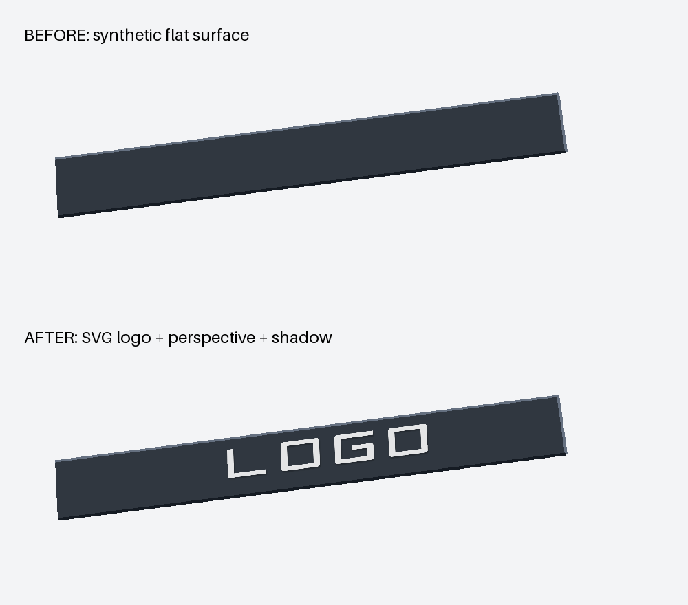

# Agent skills

Skills for AI agents that read `SKILL.md` (Claude Code, Codex and others), taken from my day-to-day work building and running AI-managed online stores at [StoreKite](https://storekite.ai). Each one is something I actually use, cleaned of anything specific to my clients.

| Skill | What it does |
|---|---|
| [product-photo-studio](plugins/product-photo-studio/skills/product-photo-studio/SKILL.md) | Product images from a real product photo with Gemini on Vertex AI: an intake interview, a modular prompt builder with colour and logo locks, free request previews, local request limits and a review checklist. |

## Install

**Claude Code**

```
/plugin marketplace add Bubiec/agent-skills
/plugin install product-photo-studio@bubiec
```

**Codex**: copy `plugins/product-photo-studio/skills/product-photo-studio` into `~/.codex/skills/`.

**Any other agent**: copy the skill folder into your project and add one line to your `AGENTS.md` (or equivalent) pointing product-image tasks at its `SKILL.md`.

## product-photo-studio in one minute

```
intake questions → job.toml → build_prompt.py → prompt.txt → generate.py (preview, free) → generate.py --execute (paid) → review
```

- **The agent interviews you first**: product, reference photo, which colour must be exact, logo or no logo, budget, rights. Existing answers are reused; missing product and budget decisions are clarified.
- **Prompts are assembled from modules**, one per concern: product lock, camera, background, colour lock, logo, exclusions. One value lives in one place, so two runs never contradict each other. Reference images are numbered automatically ("Image 2 is the colour sample").
- **Logos get their own module**: keep or replace a mark, automatically export SVG references to PNG, or apply the artwork locally with a four-corner perspective transform, opacity, multiply blending and optional shadow.
- **Money is guarded in layers**: preview by default, `--execute` for every paid call, local daily and monthly request limits, an extra flag for 4K, and a setup guide for a dedicated project with quotas.

See [examples/orange-lens-eyewear](plugins/product-photo-studio/skills/product-photo-studio/examples/orange-lens-eyewear) for a full job file and the prompt it produces.

### Local logo placement, no image generation

```bash
cd plugins/product-photo-studio/skills/product-photo-studio
python -m pip install -r requirements.txt
python examples/logo-placement/create_demo.py --out out/logo-demo
```

The demo builds a synthetic surface and places the included vector mark. For your
own render, specify four surface corners in `placement.toml`, then run
`python scripts/composite_logo.py placement.toml`. SVG rendering and compositing
run locally without credentials or paid API calls. See the [logo guide](plugins/product-photo-studio/skills/product-photo-studio/references/logo.md).



## Security

Local counters are not a billing cap. They apply only to processes sharing the same ledger; other machines and tools are outside their scope. SDK retries are disabled and failed attempts still count.

No credentials live in this repository or in any job file. Image generation authenticates with Google Application Default Credentials on your machine. Every push is scanned for secrets.

## License

- Code (`*.py`, workflows): [MIT](LICENSE).
- Prompts, modules, documentation and examples: [CC BY 4.0](LICENSE-CONTENT.md). Use them, change them, sell what you make with them; credit "Szymon Bubała, github.com/Bubiec/agent-skills".

## About

I'm Szymon Bubała. I build and run AI-managed e-commerce stores myself, a few stores a year: [storekite.ai](https://storekite.ai). If you want this kind of setup working in your own store rather than assembling it yourself, that's what I do.

## Local checks

Requires Python 3.11 or newer. Request previews use only the standard library;
SVG and compositing tests require Pillow and resvg-py. Install the skill requirements
for the full workflow (including paid generation).

```bash
python -m pip install -r plugins/product-photo-studio/skills/product-photo-studio/requirements.txt
python -m unittest discover -s tests -v
claude plugin validate .
gitleaks dir . --redact --no-banner
```

The eyewear example contains no product, colour or logo reference images. Supply
your own files in its ignored `refs/` folder. The logo demo contains only original
synthetic artwork. A preview means inspecting a JSON request, not generating a free
image. Keep each generation in a new output directory so earlier requests and
images remain reviewable.
